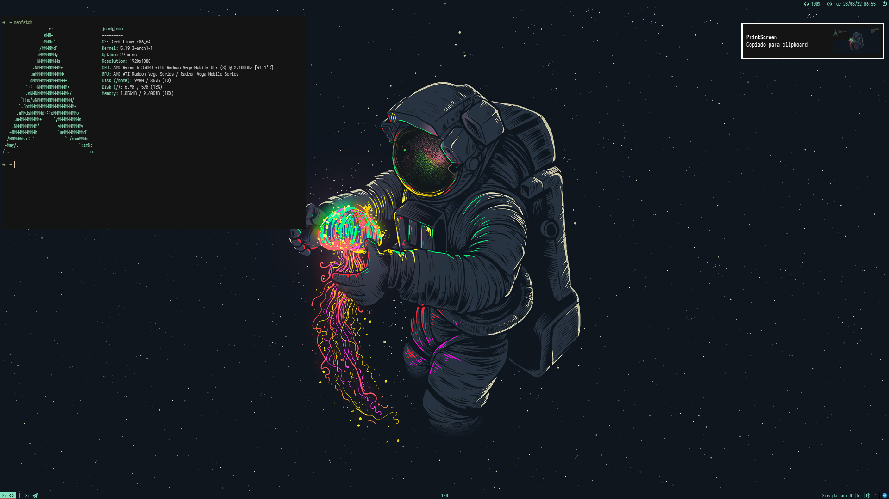

[Guia-Arch](https://github.com/JoaoPedroPierri/dotfiles/blob/master/archlinux-install.md)

# ***`CURRENT SETUP:`***
| Tipos               | Softwares                                                                                                                           |
| :------------------ | :---------------------------------------------------------------------------------------------------------------------------------- |
| Linux distribution        | [Arch Linux](https://wiki.archlinux.org/index.php/Installation_guide_(Portugu%C3%AAs))                                                                                            |                                                                                       
| Window Manager  | [Hyprland](https://hypr.land/) (Wayland)                                                                                             
| Browser           | [Google Chrome](https://aur.archlinux.org/packages/google-chrome/)                                                                                |
| Program Launcher | [Wofi](https://hg.sr.ht/~scoopta/wofi)                                                                                         |           
| Status Bar     | [Waybar](https://github.com/Alexays/Waybar)                                                                                         |     									    |                                					     	 	    
| Vídeo Player        | [MPV](https://mpv.io/)														    |
| Music Player | [Spotify](https://aur.archlinux.org/packages/spotify/)                   								    |
| Image viewer | [Viewnior](http://siyanpanayotov.com/project/viewnior)                                                                                                                                                                                             
| Print Screen     | [grim + slurp](https://github.com/JoaoPedroPierri/dotfiles/blob/master/bin/shot)                                                                               |
| Terminal Emulator   | [Kitty](https://github.com/kovidgoyal/kitty)                                                                                 |
| Shell               | [ZSH](https://wiki.archlinux.org/index.php/Zsh)                                                                                                         
| Text editor     | [NeoVim](https://github.com/neovim/neovim)                                                    							    |
| Lockscreen    | [Hyprlock](https://github.com/hyprwm/hyprlock) + fortune                                                                                                  
| Notification Daemon   | [Dunst](https://github.com/dunst-project/dunst)                                                                                    
| Development   | [NeoVim](https://github.com/neovim/neovim)

# Hyprland

GPU **AMD**, teclado **português (Portugal)**, configuração em **Lua** (Hyprland 0.55+).

### Instalar

```
git clone https://github.com/JoaoPedroPierri/dotfiles
bash dotfiles/install/arch-install.sh      # Arch Linux (live ISO)
```

Depois do primeiro arranque (dentro do Hyprland):

```
~/.joao-repo/dotfiles/hyprland-install
```

Ver o [guia completo](archlinux-install.md).

# Setup antigo (i3 Gaps)

Guardado em [`legacy-i3/`](legacy-i3/).


